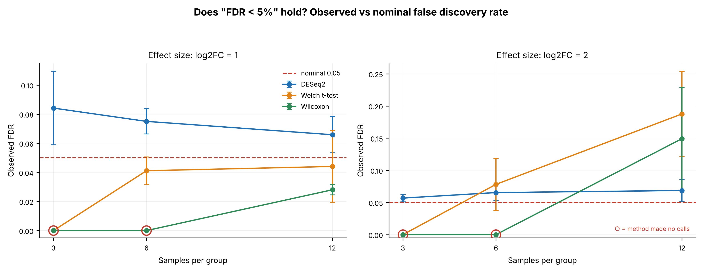

# rnaseq-de-benchmark

**A reproducible Snakemake workflow that asks whether a differential-expression method does what it claims.**

[](https://github.com/DhruvASharma2004/rnaseq-de-benchmark/actions/workflows/ci.yml)
[](https://www.python.org/)
[](https://snakemake.readthedocs.io/)
[](#license)

Every RNA-seq paper reports genes at "FDR < 5%". Whether that number means
anything depends on the method, the sample size, and the effect size — and you
cannot check it on real data, because real data never tells you which genes are
truly null.

This workflow simulates RNA-seq counts whose ground truth is known by
construction, runs three differential-expression methods on identical data, and
measures what they actually deliver: observed false discovery rate against the
nominal level, statistical power, ranking quality, and effect-size accuracy.

<p align="center">
  
</p>

<p align="center"><em>The headline result. DESeq2 (blue) stays near its promise at every
sample size. The CPM-based tests get <strong>worse as samples are added</strong>, reaching an
observed FDR of 0.19 at n=12 against a nominal 0.05. Open circles mark runs where a
method made no calls at all.</em></p>

---

## Table of contents

- [What this measures](#what-this-measures)
- [Installation](#installation)
- [Running it](#running-it)
- [Workflow structure](#workflow-structure)
- [Results](#results)
- [Three findings worth the runtime](#three-findings-worth-the-runtime)
- [How the simulation works](#how-the-simulation-works)
- [Configuration](#configuration)
- [Testing and CI](#testing-and-ci)
- [Repository layout](#repository-layout)
- [Limitations](#limitations)
- [License and references](#license-and-references)

---

## What this measures

| Metric | Question |
|---|---|
| `observed_fdr` | Of the genes called at `padj < 0.05`, how many were actually null? |
| `power` | What share of truly differential genes was recovered? |
| `auroc`, `average_precision` | How good is the ranking, independent of any threshold? |
| `lfc_bias`, `lfc_rmse` | Are the reported fold changes the real ones? |
| `min_pvalue` | What is the smallest p-value the method could produce at this n? |
| `n_called` | How many genes were called — because an FDR of 0 means nothing if the answer is "none"? |

Three methods are compared on identical simulated data:

- **DESeq2** (via `pydeseq2`) — negative-binomial GLM with empirical-Bayes dispersion shrinkage
- **Welch t-test** on log2 CPM — the quick approach
- **Wilcoxon rank-sum** on log2 CPM — the distribution-free approach

---

## Installation

**conda (recommended):**

```bash
git clone https://github.com/DhruvASharma2004/rnaseq-de-benchmark.git
cd rnaseq-de-benchmark
conda env create -f environment.yml
conda activate de-benchmark
```

**pip / venv:**

```bash
git clone https://github.com/DhruvASharma2004/rnaseq-de-benchmark.git
cd rnaseq-de-benchmark
python -m venv .venv && source .venv/bin/activate
pip install -r requirements.txt
```

---

## Running it

```bash
snakemake --cores 4                                      # full benchmark (~4 min)
snakemake --cores 2 --configfile config/ci.yaml          # small smoke run (~20 s)
snakemake --cores 4 --config scenarios='{"n_per_group":[5],"log2fc":[1.5],"seed":[1,2]}'
snakemake -n                                             # dry run: show the plan
snakemake --dag | dot -Tpng > assets/dag.png             # render the DAG
pytest -q                                                # 26 tests
```

Outputs land in `results/`:

```text
results/
├── benchmark_summary.csv      one row per scenario x method
├── benchmark_report.md        written summary, including every FDR breach
├── figures/
│   ├── fdr_control.png
│   ├── power_by_sample_size.png
│   ├── roc_pr_curves.png
│   └── effect_size_accuracy.png
├── datasets/                  simulated counts, metadata, ground truth
├── de/                        per-method results and metrics
└── logs/                      one log per job
```

---

## Workflow structure

```text
simulate ──> run_method ──> evaluate ──┐
 (18 datasets) (×3 methods)            ├──> aggregate ──> figures
                                       │                └─> report
                                       └── curves ───────┘
```

Each scenario is simulated **once** and handed to every method, so methods are
compared on identical data rather than on separate random draws — the
difference between measuring a method and measuring the noise between runs.

Scatter-gather is expressed through Snakemake wildcards
(`n{n}_lfc{lfc}_seed{seed}__{method}`), so the grid is widened by editing
`config/config.yaml` rather than any code, jobs run in parallel across cores,
and re-running only recomputes what changed.

---

## Results

Full grid: 3 sample sizes × 2 effect sizes × 3 seeds × 3 methods = **54 runs**,
4,000 genes each, 10% truly differential, nominal FDR 0.05. Produced by
`snakemake --cores 4` in this repository; every number below is from
`results/benchmark_summary.csv`.

| method | n/group | observed FDR | power | AUROC | genes called | log2FC bias | max min-p |
|:---|---:|---:|---:|---:|---:|---:|---:|
| **DESeq2** | 3 | 0.0705 | 0.478 | 0.881 | 204 | −0.008 | 0 |
| **DESeq2** | 6 | 0.0702 | 0.680 | 0.944 | 292 | +0.004 | 0 |
| **DESeq2** | 12 | 0.0673 | **0.834** | 0.975 | 358 | −0.005 | 0 |
| Welch t-test | 3 | 0.000 | 0.001 | 0.851 | 0.5 | −0.076 | 0.0002 |
| Welch t-test | 6 | 0.0596 | 0.449 | 0.930 | 194 | −0.073 | 0 |
| Welch t-test | 12 | **0.1158** | 0.775 | 0.969 | 360 | −0.071 | 0 |
| Wilcoxon | 3 | 0.000 | 0.000 | 0.824 | **0** | −0.062 | **0.064** |
| Wilcoxon | 6 | 0.000 | 0.000 | 0.927 | **0** | −0.070 | **0.0043** |
| Wilcoxon | 12 | 0.0886 | 0.738 | 0.968 | 332 | −0.077 | 0 |

21 of 54 runs exceeded the nominal FDR by more than 25%. The worst single run
was the t-test at n=12, log2FC=2: **observed FDR 0.264** — one call in four was
a false positive, from a method reporting 5%.

---

## Three findings worth the runtime

### 1. The t-test gets *worse* as you add samples

Observed FDR climbs from 0.00 at n=3, to 0.060 at n=6, to **0.116 at n=12**.
That is the opposite of the usual intuition that more data is safer.

The mechanism: at n=3 the t-test has essentially no power (0.001) and makes
almost no calls, so it cannot be wrong. As n grows it starts calling genes —
but a t-test on log-CPM models neither the mean-variance relationship of counts
nor the extra noise in lowly expressed genes, so a growing share of those calls
are null genes that happened to have small within-group variance. Power and
false discoveries rise together, and the false discoveries rise faster.

An analyst who checked their pipeline on a small pilot and scaled up would have
seen exactly the wrong signal.

### 2. Wilcoxon cannot make a discovery at n ≤ 6, whatever the effect size

At three samples per group the smallest p-value a rank-sum test can return is
**0.064** — there are only 20 ways to arrange 3 versus 3, so no arrangement is
rarer than that. After multiple-testing correction across 4,000 genes, nothing
survives. The method called **zero** genes in every n=3 and n=6 scenario,
including at log2FC = 2.

What makes this sharp is that its *ranking* is fine: AUROC 0.82 at n=3 and 0.93
at n=6. The information is there; the test simply cannot express it as a
significant p-value. Ranking quality and thresholded calls are different
questions, and a benchmark that reported only AUROC would have missed this
completely.

This is a property of rank tests, not of this implementation, and it is why
recommending "just use a non-parametric test" for small-n RNA-seq is bad advice.

### 3. CPM normalisation biases every fold change downward

Both CPM-based methods report fold changes about **0.07 log2 units too low**,
consistently, at every sample size. DESeq2 is essentially unbiased (−0.005).

The cause is composition. Fold changes are multiplicative, so balanced
up- and down-regulation does not cancel: doubling a gene adds its own mass
again, while halving one removes only half of it. The library therefore grows,
and dividing by total counts makes every unchanged gene look slightly
down-regulated. DESeq2's median-of-ratios size factors are robust to this;
total-count scaling is not.

This one surfaced as a failing unit test — I had assumed CPM would be unbiased
on balanced data, and it is not. The test now documents the effect
(`test_balanced_fold_changes_still_inflate_the_library`).

---

## How the simulation works

Counts are drawn from a negative binomial with the features that make real
RNA-seq hard:

- **Mean-dispersion trend** — `disp(μ) = 0.05 + 6/(μ + 10)`, so lowly expressed
  genes are noisier, as reported for real libraries.
- **Log-normal expression spectrum** — most genes lowly expressed, a few
  dominating the library.
- **Library-size variation** between samples, so normalisation matters.
- **Balanced up- and down-regulation**, so a global shift cannot be absorbed by
  normalisation and the benchmark stays honest.
- **Optional outlier samples** with 4× inflated dispersion.

Ground truth — which genes moved and by exactly how much — is written alongside
the counts. Every dataset is a deterministic function of its seed.

---

## Configuration

Everything is in `config/config.yaml`; no code changes are needed to widen the
grid.

```yaml
simulation:
  n_genes: 4000
  frac_de: 0.10
  lfc_spread: 0.25
  library_size_sd: 0.25
  n_outlier_samples: 0
scenarios:
  n_per_group: [3, 6, 12]
  log2fc: [1.0, 2.0]
  seed: [1, 2, 3]
methods: [deseq2, ttest, wilcoxon]
alpha: 0.05
```

Adding a method means adding one function to `src/methods.py` and one entry to
the `METHODS` registry; the workflow, metrics, figures, and report pick it up
automatically.

---

## Testing and CI

```bash
pytest -q        # 26 passed
```

The suite is written against statistical behaviour, not just execution:

- **Simulator** — truth and fold changes agree exactly; counts are non-negative
  integers; the same seed reproduces the same data and a different seed does
  not; the requested effect is recovered net of composition; bad arguments
  raise.
- **Benjamini–Hochberg** — implemented in-repo (the benchmark's subject is FDR,
  so the correction should not be a black box) and checked against
  `statsmodels` to 1e-12, plus monotonicity, bounds, and NaN handling.
- **Metrics** — AUROC and average precision match `scikit-learn` exactly,
  including tied scores; FDR and power verified against a hand-built case with
  a known answer; a zero-call run is checked to report 0 calls rather than
  claiming perfect accuracy.
- **Methods** — all three return the same frame shape and recover an obvious
  signal; the Wilcoxon p-value floor at n=3 is asserted directly.
- **Workflow** — the Snakemake DAG is required to parse and resolve.

GitHub Actions runs the tests on Python 3.11, 3.12 and 3.13, then executes the
**whole workflow** on `config/ci.yaml` and asserts the summary table is the
expected shape and that no method ranks worse than chance. Benchmark outputs
are uploaded as build artifacts.

---

## Repository layout

```text
rnaseq-de-benchmark/
├── workflow/
│   ├── Snakefile              # the DAG: simulate -> de -> evaluate -> report
│   └── scripts/               # thin wrappers; logic lives in src/
├── src/
│   ├── simulate.py            # NB count simulator with ground truth
│   ├── methods.py             # DESeq2 / t-test / Wilcoxon + BH correction
│   ├── evaluate.py            # FDR, power, AUROC, effect-size accuracy
│   └── plots.py               # the four benchmark figures
├── config/
│   ├── config.yaml            # full grid
│   └── ci.yaml                # small grid for CI
├── tests/test_benchmark.py    # 26 tests
├── .github/workflows/ci.yml   # tests + full workflow run on 3 Python versions
├── assets/                    # figures embedded above
└── results/                   # outputs (git-ignored; regenerate with snakemake)
```

---

## Limitations

- **A benchmark is only as good as its generative model.** These counts come
  from a negative binomial with a specific dispersion trend. DESeq2 assumes
  that same family, which plausibly flatters it; a simulator built on
  resampled real data would be a fairer test and is the obvious next step.
- **DESeq2's mild excess is not fully explained.** It sits at ~0.07 against a
  nominal 0.05 across every scenario. That may be the known slight
  anti-conservatism of its independent filtering, or a mismatch between my
  dispersion trend and its prior. I have not separated those causes, and the
  README should not pretend otherwise.
- **Three methods, not a field survey.** edgeR, limma-voom and the newer
  count-aware tests are absent, mostly because they need R.
- **Two-group comparisons only.** No covariates, batch effects, paired designs,
  or multi-factor models.
- **No dependence between genes.** Real expression is correlated, which affects
  the variance of the false discovery proportion even when its mean is
  controlled.

---

## License and references

MIT — see [LICENSE](LICENSE).

> Love MI, Huber W, Anders S (2014). Moderated estimation of fold change and
> dispersion for RNA-seq data with DESeq2. *Genome Biology* 15:550.
>
> Benjamini Y, Hochberg Y (1995). Controlling the false discovery rate.
> *JRSS B* 57(1):289–300.
>
> Robinson MD, Oshlack A (2010). A scaling normalization method for
> differential expression analysis of RNA-seq data. *Genome Biology* 11:R25.
>
> Mölder F, et al. (2021). Sustainable data analysis with Snakemake.
> *F1000Research* 10:33.
